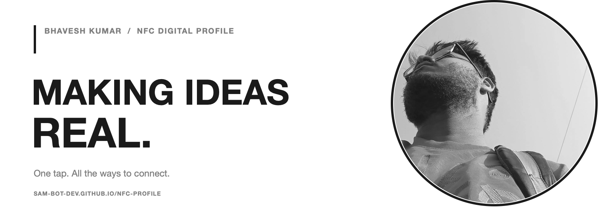

<p align="center">
  
</p>

<div align="center">

# NFC Profile

**One tap. All the ways to connect.**

[](https://sam-bot-dev.github.io/NFC-Profile/)
[](https://github.com/Sam-bot-dev/NFC-Profile)

*A personal digital contact card made to share in a tap.*

</div>

---

## ✨ The idea

Tap an NFC card—or open the link—to find Bhavesh's contact details and profiles in one clean, mobile-friendly place. No app or account is required.

## 🚀 What’s inside

| | Feature | What it does |
|:--:|---|---|
| 🎨 | **Editorial portfolio** | A bold, image-led cover with a responsive layout |
| 🌓 | **Light & dark themes** | Switch themes and keep your preference on this device |
| 📇 | **Save contact** | Download a vCard that can be added to your contacts |
| 🔗 | **Share profile** | Share the page or copy its link |
| 📬 | **Direct contact links** | Open phone, email, GitHub, and LinkedIn |
| 📱 | **NFC-ready** | Write the live website URL to an NFC card |

## 📲 Put it on an NFC card

1. Open the live profile: **[sam-bot-dev.github.io/NFC-Profile](https://sam-bot-dev.github.io/NFC-Profile/)**.
2. In an NFC writing app, choose **Write → Add a record → URL/URI**.
3. Paste the profile URL and write it to your NFC card.
4. Tap the card with a phone to test it.

The NFC card stores only the link. Visitors can open the profile in their browser and choose **Save contact** if they want the vCard.

## 💻 Run it locally

```bash
git clone https://github.com/Sam-bot-dev/NFC-Profile.git
cd NFC-Profile
python3 -m http.server 8000
```

Then open [localhost:8000](http://localhost:8000). The site is static; no build step or backend is needed.

## 🗂️ Project layout

```text
.
├── index.html
├── styles.css
├── script.js
└── assets/
    ├── Minding the Mind Portfolio Cover.png
    ├── minding-the-mind-transparent.png
    ├── portrait-poster.png
    └── readme-banner.png
```

## 🔗 Find me

[GitHub · Sam-bot-dev](https://github.com/Sam-bot-dev) ·
[LinkedIn · Bhavesh Kumar](https://www.linkedin.com/in/l-bhavesh) ·
[Contact profile](https://sam-bot-dev.github.io/NFC-Profile/)

---

<div align="center">
  <sub>Made to connect · Bhavesh Kumar · Gandhinagar, India</sub>
</div>
